# Reportes de bugs: SauceDemo

**Ambiente:** https://www.saucedemo.com, Google Chrome, Windows
**Línea base:** `standard_user`, que funciona correctamente en todos los casos.

## Resumen

| ID | Título | Usuario | Severidad |
|---|---|---|---|
| BUG-01 | El botón Finish no permite completar la compra | `error_user` | Alta |
| BUG-02 | En checkout, Last Name modifica First Name y Continue no avanza | `problem_user` | Alta |
| BUG-03 | Un producto muestra "Item not found" y no aparece en el carrito | `problem_user` | Alta |
| BUG-04 | Los precios de la lista no coinciden con los del detalle y el carrito | `visual_user` | Alta |
| BUG-05 | No permite agregar todos los productos ni quitarlos desde la lista y el detalle | `error_user`, `problem_user` | Media |
| BUG-06 | En checkout, Last Name no muestra lo escrito y no valida que esté vacío | `error_user` | Media |
| BUG-07 | El ordenamiento de productos no funciona | `error_user`, `problem_user`, `visual_user` | Media |
| BUG-08 | La página carga con demoras en varias pantallas | `performance_glitch_user` | Media |
| BUG-09 | Imágenes de productos incorrectas | `problem_user`, `visual_user` | Media |
| BUG-10 | Elementos desalineados o fuera de lugar | `visual_user` | Baja |

---

### BUG-01: El botón Finish no permite completar la compra
- **Usuario:** `error_user`
- **Severidad:** Alta
- **Módulo:** Checkout
- **Caso relacionado:** TC-16
- **Pasos para reproducir:**
  1. Iniciar sesión con `error_user`
  2. Agregar un producto al carrito (la mochila, por ejemplo)
  3. Abrir el carrito, hacer clic en Checkout y completar los datos del comprador
  4. Hacer clic en Continue
  5. En la pantalla de resumen, hacer clic en Finish
- **Resultado esperado:** se completa la compra y aparece el mensaje de confirmación
- **Resultado real:** el botón Finish no permite completar la compra
- **Comparación:** con `standard_user` la compra se completa
- **Evidencia:**
  - `standard_user` (esperado): 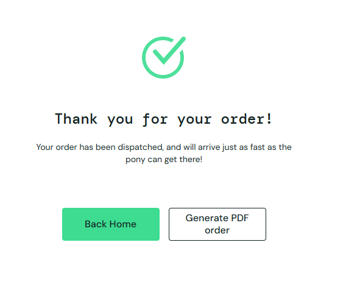
  - `error_user` (observado): 

### BUG-02: En checkout, Last Name modifica First Name y Continue no avanza
- **Usuario:** `problem_user`
- **Severidad:** Alta
- **Módulo:** Checkout
- **Caso relacionado:** TC-14
- **Pasos para reproducir:**
  1. Iniciar sesión con `problem_user`
  2. Agregar un producto al carrito (la mochila, por ejemplo)
  3. Abrir el carrito y hacer clic en Checkout
  4. Escribir el nombre, el apellido (Last Name) y el código postal
  5. Hacer clic en Continue
- **Resultado esperado:** los datos se completan correctamente y permite pasar a la pantalla de resumen del pedido
- **Resultado real:** al escribir en Last Name no aparece nada en ese campo y se modifica el campo First Name; Continue no permite avanzar
- **Comparación:** con `standard_user` los datos se completan y permite continuar
- **Evidencia:**
  - `standard_user` (esperado): 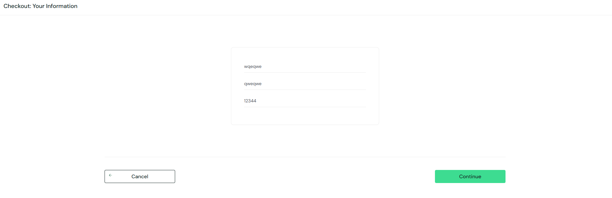
  - `problem_user` (observado): [Video](../evidence/Problem_user/problem_user_glitch.mp4)

### BUG-03: Un producto muestra "Item not found" y no aparece en el carrito aunque el contador sube
- **Usuario:** `problem_user`
- **Severidad:** Alta
- **Módulo:** Carrito / Detalle de producto
- **Caso relacionado:** TC-12
- **Pasos para reproducir:**
  1. Iniciar sesión con `problem_user`
  2. En la lista de productos, hacer clic en el nombre de "Sauce Labs Fleece Jacket"
  3. En la página del producto, hacer clic en "Add to cart"
  4. Observar el contador del carrito y luego abrir el carrito
- **Resultado esperado:** la página del producto muestra su nombre, foto, descripción y precio, y después de agregarlo, el producto aparece en el carrito
- **Resultado real:** la página del producto muestra "Item not found". El botón "Add to cart" funciona y el contador del carrito sube en 1, pero al abrir el carrito está vacío
- **Comparación:** con `standard_user` la página del producto se ve completa y el producto aparece en el carrito
- **Nota:** desde la lista de productos no permite agregar este producto (ver BUG-05)
- **Evidencia:**
  - `standard_user` (esperado): 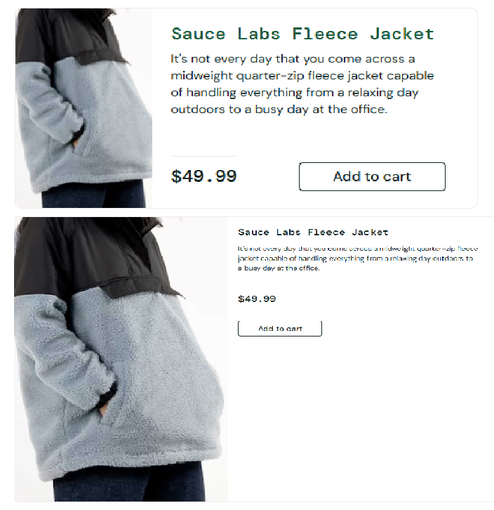
  - `problem_user` (observado): 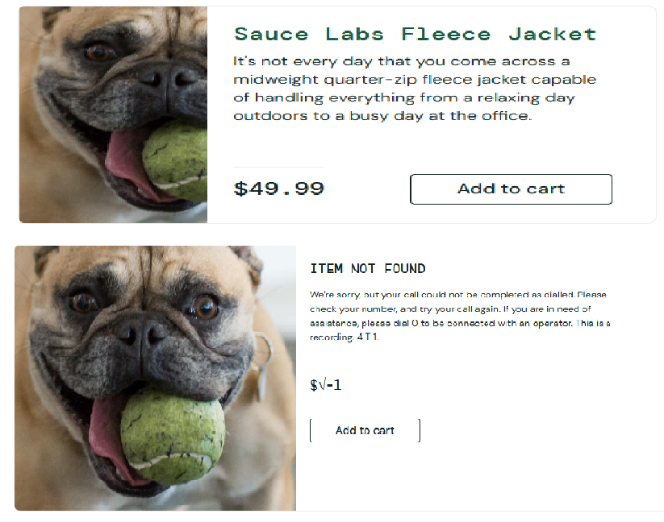

### BUG-04: Los precios de la lista no coinciden con los del detalle y el carrito
- **Usuario:** `visual_user`
- **Severidad:** Alta
- **Módulo:** Inventario / Carrito
- **Caso relacionado:** TC-10
- **Pasos para reproducir:**
  1. Iniciar sesión con `visual_user`
  2. En la lista de productos, anotar el precio de un producto (la mochila, por ejemplo)
  3. Entrar al detalle del producto y comparar el precio
  4. Agregarlo al carrito, abrir el carrito y comparar el precio
- **Resultado esperado:** el precio es el mismo en la lista, el detalle y el carrito
- **Resultado real:** el precio de la lista es distinto al del detalle y al del carrito. Pasa con los 6 productos. Ejemplo: (Sauce Labs Backpack: $40.25 en la lista y $29.99 en el detalle)
- **Comparación:** con `standard_user` el precio es el mismo en las tres pantallas
- **Evidencia:**
  - `standard_user` (esperado): 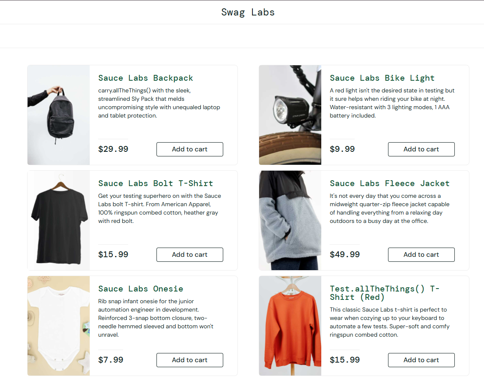
  - `visual_user` (observado): 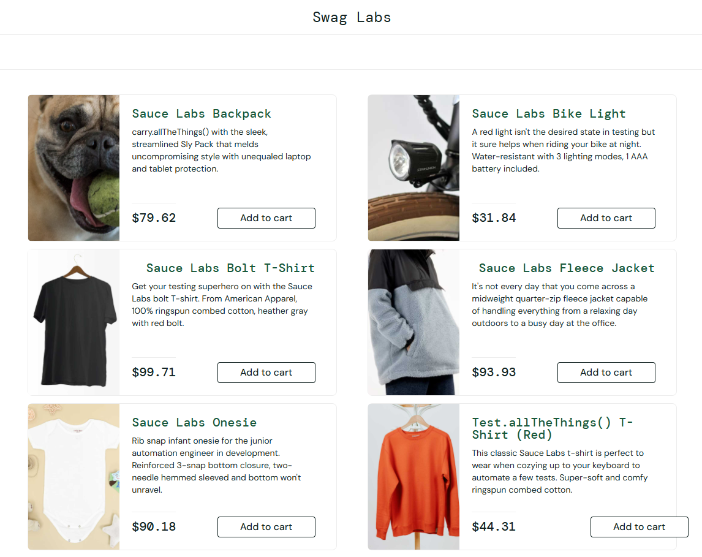

### BUG-05: No permite agregar todos los productos ni quitarlos desde la lista y el detalle
- **Usuario:** `error_user`, `problem_user`
- **Severidad:** Media
- **Módulo:** Inventario
- **Caso relacionado:** TC-08, TC-11
- **Pasos para reproducir:**
  1. Iniciar sesión con `error_user` (repetir con `problem_user`)
  2. En la lista de productos, hacer clic en "Add to cart" en los 6 productos
  3. Entrar al detalle de cada producto y hacer clic en "Add to cart" en los que no se agregaron
  4. Intentar quitar los productos agregados con "Remove", desde la lista y desde el detalle
  5. Abrir el carrito e intentar quitarlos desde ahí
- **Resultado esperado:** permite agregar los 6 productos y quitarlos desde la lista, el detalle y el carrito
- **Resultado real:**
  - `error_user`: solo permite agregar 3 productos (Sauce Labs Backpack, Bike Light y Onesie), tanto desde la lista como desde el detalle. No permite quitarlos desde la lista ni desde el detalle; solo desde el carrito
  - `problem_user`: desde la lista solo permite agregar los mismos 3 productos. Los otros 3 sí se pueden agregar desde el detalle. No permite quitar desde la lista, y en el detalle el botón sigue diciendo "Add to cart" aunque el producto ya está agregado. Desde el carrito sí se puede quitar
- **Comparación:** con `standard_user` se pueden agregar los 6 productos y quitarlos desde la lista, el detalle y el carrito
- **Evidencia:**
  - `standard_user` (esperado): 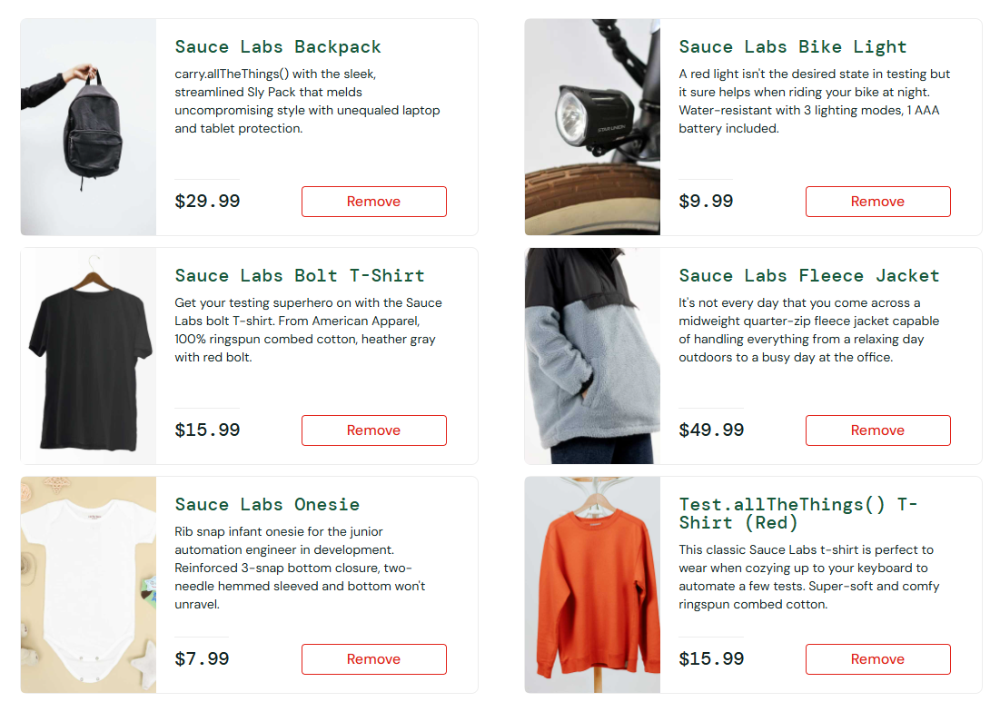
  - `error_user` (observado): 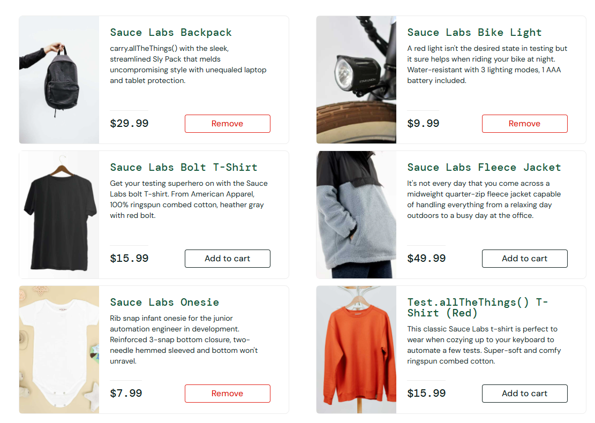
  - `problem_user` (observado): [Video](../evidence/Problem_user/problem_user_glitch.mp4)

### BUG-06: En checkout, Last Name no muestra lo escrito y no valida que esté vacío
- **Usuario:** `error_user`
- **Severidad:** Media
- **Módulo:** Checkout
- **Caso relacionado:** TC-14, TC-15
- **Pasos para reproducir:**
  1. Iniciar sesión con `error_user`
  2. Agregar un producto al carrito (la mochila, por ejemplo)
  3. Abrir el carrito y hacer clic en Checkout
  4. Escribir el nombre y el código postal, y tratar de escribir un apellido en Last Name
  5. Hacer clic en Continue
- **Resultado esperado:** el apellido se muestra en el campo, y si el campo queda vacío, no permite avanzar y muestra el error "Error: Last Name is required"
- **Resultado real:** al escribir en Last Name no aparece nada en el campo. Aun con el campo vacío, Continue permite pasar a la pantalla de resumen sin mostrar ningún error
- **Comparación:** con `standard_user` el apellido se muestra y, si el campo está vacío, aparece "Error: Last Name is required" y no deja avanzar
- **Nota:** después de este paso, el botón Finish tampoco funciona (ver BUG-01)
- **Evidencia:**
  - `standard_user` (esperado): 
  - `error_user` (observado): 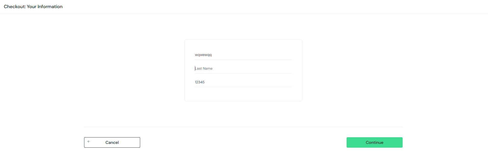

### BUG-07: El ordenamiento de productos no funciona
- **Usuario:** `error_user`, `problem_user`, `visual_user`
- **Severidad:** Media
- **Módulo:** Inventario
- **Caso relacionado:** TC-07
- **Pasos para reproducir:**
  1. Iniciar sesión con `error_user` (repetir con `problem_user` y `visual_user`)
  2. Abrir el desplegable de ordenar, arriba a la derecha
  3. Elegir cada opción: nombre (A a Z y Z a A) y precio (menor a mayor y mayor a menor)
- **Resultado esperado:** la lista se reordena correctamente según la opción elegida
- **Resultado real:**
  - `error_user`: muestra el mensaje "Sorting is broken! This error has been reported to Backtrace." con las 4 opciones
  - `problem_user`: la lista no cambia y no aparece ningún aviso
  - `visual_user`: la lista se reordena de forma aleatoria, sin respetar el nombre ni el precio
- **Comparación:** con `standard_user` el ordenamiento por nombre y por precio funciona bien
- **Evidencia:**
  - `standard_user` (esperado): 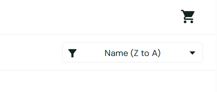
  - `error_user` (observado): 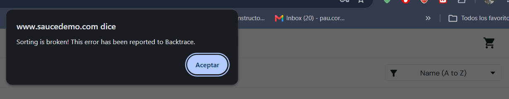
  - `problem_user` (observado): [Video](../evidence/Problem_user/problem_user_glitch.mp4)
  - `visual_user` (observado): [Video](../evidence/Visual_user/visual_user_no_order.mp4), la lista se reordena de forma aleatoria

### BUG-08: La página carga con demoras en varias pantallas
- **Usuario:** `performance_glitch_user`
- **Severidad:** Media
- **Módulo:** General
- **Caso relacionado:** Hallazgo de exploración
- **Pasos para reproducir:**
  1. Iniciar sesión con `performance_glitch_user`
  2. Abrir una opción del menú, entrar al detalle de un producto y volver a la lista
  3. Abrir el carrito y hacer clic en "Continue Shopping"
  4. Cambiar el orden de la lista
  5. Completar una compra y volver al inicio
- **Resultado esperado:** todas las pantallas cargan de inmediato
- **Resultado real:** el login tarda cerca de 6 segundos y las acciones de los pasos 2 a 5 también se demoran en cargar. Todo funciona, pero con lentitud
- **Comparación:** con `standard_user` las mismas acciones cargan de inmediato
- **Evidencia:** [Video](../evidence/Performance_glitch_user/performance_glitch_user_lag.mp4), demoras en el login y en varias pantallas

### BUG-09: Imágenes de productos incorrectas
- **Usuario:** `problem_user`, `visual_user`
- **Severidad:** Media
- **Módulo:** Inventario
- **Caso relacionado:** TC-09
- **Pasos para reproducir:**
  1. Iniciar sesión con `problem_user` (repetir con `visual_user`)
  2. Revisar las imágenes de los productos en la lista
  3. Hacer clic en un producto para abrir su detalle y comparar
- **Resultado esperado:** cada producto muestra su propia imagen y, al abrirlo, el detalle corresponde al producto elegido
- **Resultado real:**
  - `visual_user`: el primer producto muestra la imagen de un perro; en el detalle se ve la correcta
  - `problem_user`: todos los productos muestran la imagen de un perro, y al abrir un producto el detalle corresponde a otro (por ejemplo, el nombre dice camiseta pero abre la ropa de bebé)
- **Comparación:** con `standard_user` todas las imágenes corresponden a su producto
- **Evidencia:**
  - `problem_user`:
    - `standard_user` (esperado): 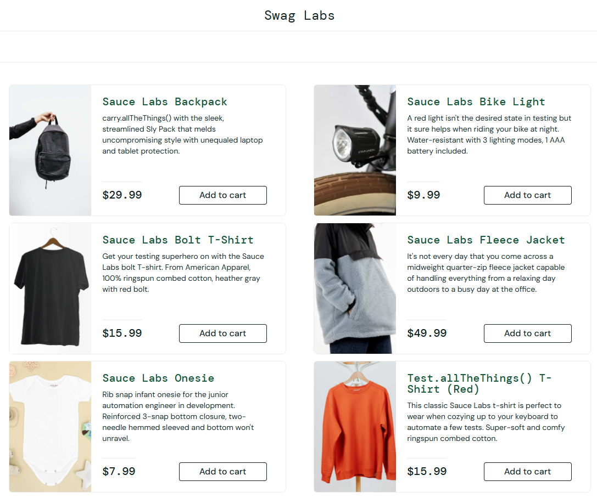
    - `problem_user` (observado): 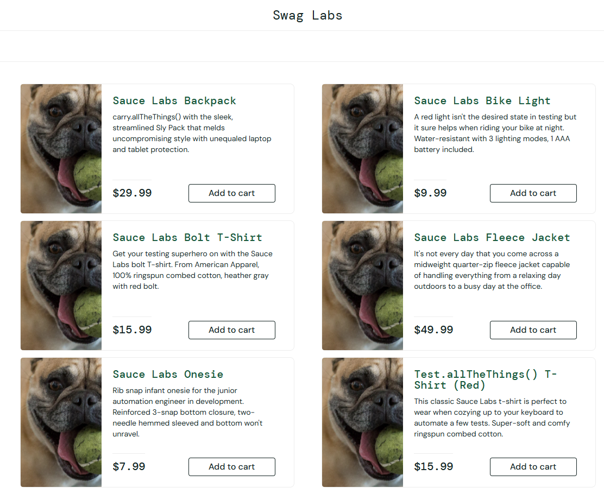
    - `problem_user` (observado): [Video](../evidence/Problem_user/problem_user_name_mismatch.mp4), el nombre del producto no coincide con el detalle que se abre
  - `visual_user`:
    - `standard_user` (esperado): 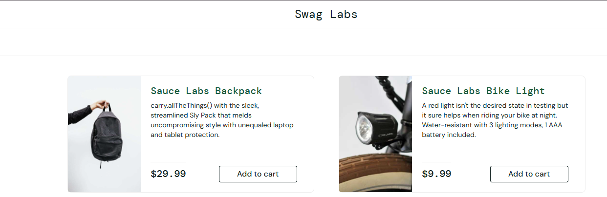
    - `visual_user` (observado): 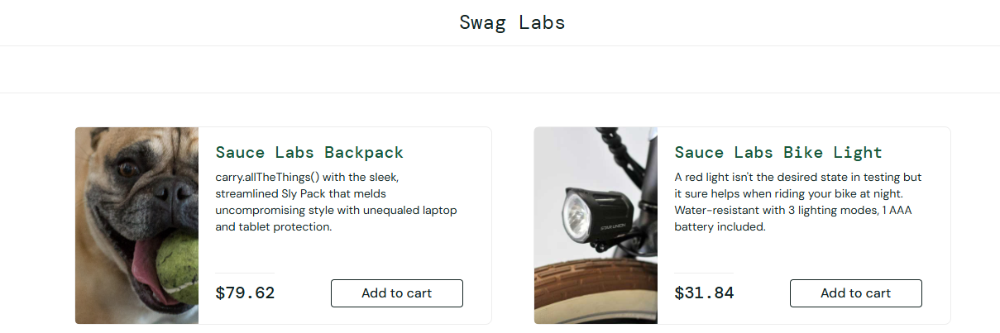

### BUG-10: Elementos desalineados o fuera de lugar
- **Usuario:** `visual_user`
- **Severidad:** Baja
- **Módulo:** Inventario / Carrito
- **Caso relacionado:** Hallazgo de exploración
- **Pasos para reproducir:**
  1. Iniciar sesión con `visual_user`
  2. Revisar la lista de productos
  3. Abrir el carrito
- **Resultado esperado:** los elementos están en su posición normal, como en `standard_user`
- **Resultado real:**
  - El ícono del carrito está desplazado y atraviesa una línea; debería estar en la esquina superior derecha
  - Los nombres de algunos productos están desalineados
  - El botón "Add to cart" del último producto está desplazado
  - En el carrito, el botón Checkout aparece arriba a la derecha; debería estar abajo, alineado con "Continue Shopping"
- **Comparación:** con `standard_user` todos los elementos están alineados
- **Evidencia:**
  - Botón "Add to cart" del último producto:
    - `standard_user` (esperado): 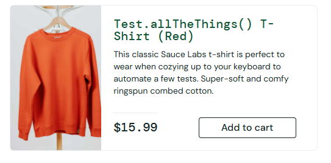
    - `visual_user` (observado): 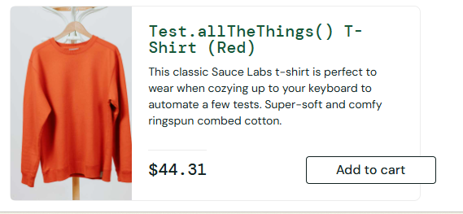
  - Botón Checkout en el carrito:
    - `standard_user` (esperado): 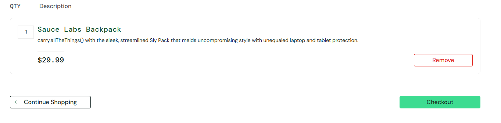
    - `visual_user` (observado): 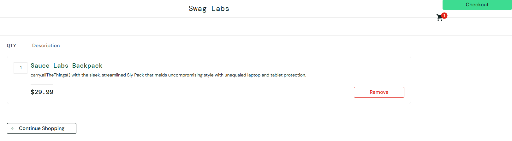
  - Nombres de los productos:
    - `standard_user` (esperado): 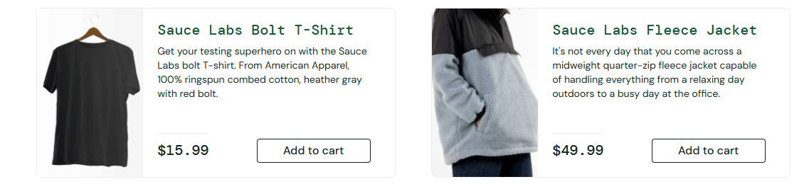
    - `visual_user` (observado): 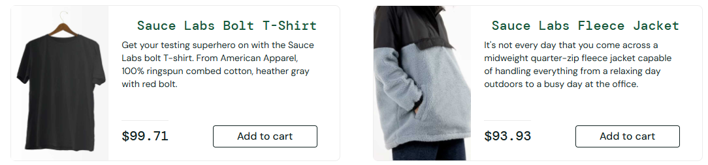
  - Carrito:
    - `standard_user` (esperado): 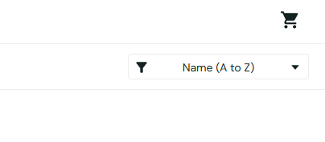
    - `visual_user` (observado): 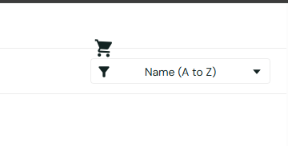